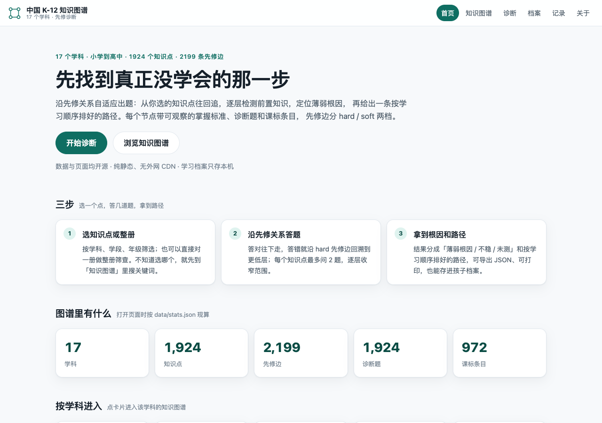
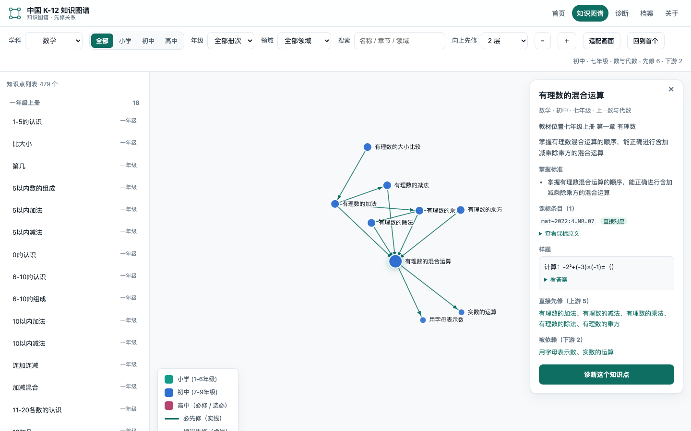

# 中国 K-12 全学科知识图谱（cn-k12-dxyc2286）

**17 个学科 · 2,190 个知识点 · 2,439 条先修边 · 4,260 道诊断题 · 1,324 条课标条目**，覆盖小学到高中。每个知识点带**可观察的掌握标准**、**节点级诊断题**、**课标条目与置信度**；先修边分 hard / soft 两档，可直接驱动前置诊断与学习路径推荐。

[](https://creativecommons.org/licenses/by/4.0/deed.zh-hans)
[](data/topics.json)
[](data/dependencies.json)
[](data/cn-curriculum-standards.json)
[](https://grantleyzyf-spec.github.io/cn-k12-dxyc2286/)

**[→ 在线浏览](https://grantleyzyf-spec.github.io/cn-k12-dxyc2286/)** · [知识图谱](https://grantleyzyf-spec.github.io/cn-k12-dxyc2286/explore/) · [自适应诊断](https://grantleyzyf-spec.github.io/cn-k12-dxyc2286/diagnose/) · [学习档案](https://grantleyzyf-spec.github.io/cn-k12-dxyc2286/children/) · [诊断记录](https://grantleyzyf-spec.github.io/cn-k12-dxyc2286/children/history.html) · [❤️ 赞助支持](https://grantleyzyf-spec.github.io/cn-k12-dxyc2286/sponsor/)






| 学段 | 知识点 | 诊断题 | 说明 |
| --- | ---: | ---: | --- |
| 小学（1–6 年级） | 412 | 1139 | 语文、数学、英语、科学、信息科技、音乐、美术、俄语、西班牙语 |
| 初中（7–9 年级） | 802 | 1434 | 语文、数学、英语、物理、化学、生物、历史、地理、信息科技、音乐、美术、俄语、西班牙语 |
| 高中（10–16 册次） | 946 | 1537 | 语文、数学、英语、物理、化学、生物、历史、地理、信息技术（信息科技）、日语、俄语、德语、法语、西班牙语、音乐、美术 |
| **合计** | **2,190** | **4,260** | — |

> 年级用 `1`–`16` 表示：`1`–`9` 为义务教育年级，`10` 以上为高中册次（必修一/二、选必一/二/三；西班牙语的必修Ⅳ 拆三册、选必拆四册，故用到 `16`），**不是**「高一到高四」，也不写教学进度。

数据格式参考 [Marble os-taxonomy](https://github.com/withmarbleapp/os-taxonomy)（`topics` + `dependencies`），并按本仓库需要扩了诊断题、课标条目、版本映射与学习档案。

**反馈 / 挑错：** 知识点拆分、掌握标准、先修关系（某条边该不该有、该是 hard 还是 soft）、诊断题答案有异议，或想提功能建议，请 [提交 Issue](https://github.com/grantleyzyf-spec/cn-k12-dxyc2286/issues/new)。

> **状态声明：这是 AI 生成的初稿，未经一线教师审核。**
> 知识点粒度、掌握标准、先修关系强度、诊断题难度都没有经过教师评审，也没有真实答题数据校准；请勿直接用于正式教学或升学判断。
> **课标对齐口径**：`standards` 非空 **2,178 / 2,190**，且这 2,142 个知识点的引文**全部**带 `quote` 并可逐字回表复核（德语 117 条、英语 232 条、语文 234 条、信息科技 135 条、法语 63 条等已收口学科回表率 100%）。未挂的 12 个知识点在课标原文里找不到可对应表述，**留空不编造**，见下方「已知局限」。
> 高中与小语种课标条目多为公开转述，未与教育部 PDF 逐页核对。

## 数据来源与对齐依据

- **课程标准**：`data/cn-curriculum-standards.json` 收录 **1,324** 条课标条目（17 个学科分桶，每桶含 `entryCount` 与 `entries`，`totals` 为 17 / 1324 / 2190 / 2178）。依据教育部《义务教育课程方案和课程标准（2022 年版）》及 2025 年日常修订版、《普通高中课程方案和课程标准（2017 年版 2020 年修订）》的公开文本；原件按学科存放在本地 `中小学教材/2025修订课程标准/`（义教 17 份、高中 24 份），另有一批 `pdftotext` 抽出的 TXT 快照。
- **课标条目 id**：按学科自编，格式 `{学科前缀}-{年份}:{学段或模块}.{序号}`，例如数学 `cms-2022:1.NA.05`、语文 `cyw-2022:1.SX.02`、德语 `dyu-2017:G.ZT.03`。**不是教育部原编号**，只在本仓库内部可追溯。
- **`quote` 规则**：`standards[]` 里出现 `quote` 时，该片段必须逐字出自对应课标文本（CI 可回表核验 `quote in 课标原文`），`sourceLine` 记录定位；做不到逐字命中的**一律不写 `quote`**，只留 id + `confidence`，不为凑满而编造。
- **`confidence`**：`exact`（课标有直接对应条款）/ `partial`（部分对应）/ `inferred`（据学段与教材推断）。
- **教材顺序**：按人教版等主流版本教材的册次与章节编排；册次地图见 `data/mappings/volume-map.json`（自动生成，覆盖全部 2,126 个知识点），跨版本字段映射见 `data/mappings/schema-mapping.json`。
- **小语种边界**：义务教育阶段外语课标只有英语 / 日语 / 俄语；法语、德语、西班牙语的义教段知识点在课标体系里无独立条文，只能挂高中课标。西班牙语例外有据：本国《普通高中西班牙语课程标准（2017 年版 2020 年修订）》把必修Ⅰ / Ⅱ / Ⅲ 明确对应义务教育七 / 八 / 九年级（课标「教学提示」要求必修Ⅲ 保证学生通过义务教育学业评价测试），故按 1 / 2 / 3 级对齐，引文逐字取自课标 PDF（见 [docs/spanish.md](docs/spanish.md)）。

## 文件与字段

```
data/
  topics.json                 # 全学科知识点（2,126 条，汇总，脚本生成，别手改）
  dependencies.json           # 先修边（2,199 条）
  questions.json              # 诊断题（2,131 道）
  cn-curriculum-standards.json# 课标条目索引（1115 条，脚本生成）
  stats.json                  # 站点与 README 用的现算统计（scripts/build_stats.py）
  subjects.json               # 学科元数据（id / 名称 / 图标 / 数量）
  schema-topic.json           # JSON Schema（根节点是 array，items 显式 type: object）
  schema-question.json
  schema-dependency.json
  curriculum-standards.json   # 课标来源元数据（各学科课标名称/版本）
  verification_report.json    # 数据核验报告
  mappings/                   # 册次地图（volume-map）、跨版本字段映射
  <subject>/                  # 17 个学科，各含 topics / dependencies / questions.json
```

### `topics.json` 字段（节点契约 v2）

| 字段 | 类型 | 说明 |
| --- | --- | --- |
| `id` | string | `{学科前缀}_{p\|h}NNN`，全库唯一（前缀 2–6 字母，序号 2–4 位） |
| `name` / `subject` / `domain` | string | 名称 / 学科 id / 领域 |
| `grade` / `semester` | string | 年级 `1`–`14` / `上`、`下`、`全`（旧 `fall`/`spring` 已迁移） |
| `chapter` | string | 教材册次 + 章节 |
| `type` | enum | `conceptual` / `procedural` / `reasoning` / `modeling` / `application` |
| `description` | string | 概念说明 |
| `mastery_criteria[]` | string[] | 1–3 条**可观察**的掌握标准，用于判定「会不会」 |
| `diagnostic_question` | object | 节点级快诊题 `{question, answer}`（题库在 `questions.json`） |
| `standards[]` | object[] | `{id, confidence, quote?, sourceLine?}`；`quote` 是防编造的硬约束 |
| `prerequisites[]` | string[] | 直接先修 id（与 `dependencies.json` 互为镜像） |
| `curriculumRef` / `tags[]` / `external` / `verified` | | 课标定位 / 标签 / 是否跨学科外部节点 / 审核标记 |

### `dependencies.json` 字段

`{ "from": "<先修知识点 id>", "to": "<后继知识点 id>", "type": "hard" | "soft" }`
`hard` = 不掌握前者基本学不会后者；`soft` = 有帮助但非必需（多为教材编排顺序）。

### `questions.json` 字段

`{ id, topicId, prompt（规范字段，12–120 字）, question（兼容别名，同值）, answer, type, difficulty, explanation, options?, verify? }`
`choice` 必须给 4 个 `{label, text}` 且 `answer` 是 label；`numeric` 的 `verify` 是能被 Python `eval` 复算的表达式。

## 分学科覆盖

| 学科 | 学段 | 教材版本 | 知识点 | 先修边 | 诊断题 | 已挂课标 | 其中带原文引文 |
| --- | --- | --- | ---: | ---: | ---: | ---: | ---: |
| 数学（`math`） | 小·初·高 | 人教版（含人教 A 版 2019） | 515 | 571 | 2575 | 512 | 512 |
| 语文（`chinese`） | 小·初·高 | 统编版 | 205 | 201 | 205 | 205 | 205 |
| 英语（`english`） | 小·初·高 | 人教 PEP / Go for it! / 人教版 2019 | 204 | 209 | 204 | 204 | 204 |
| 物理（`physics`） | 初·高 | 人教版 | 177 | 205 | 177 | 177 | 177 |
| 生物（`biology`） | 初·高 | 人教版（初中＋高中） | 140 | 205 | 140 | 140 | 140 |
| 历史（`history`） | 初·高 | 统编版 | 152 | 171 | 152 | 152 | 152 |
| 德语（`german`） | 高 | 外研社版 | 100 | 60 | 100 | 100 | 100 |
| 俄语（`russian`） | 初 | 人教版 | 96 | 106 | 96 | 96 | 96 |
| 地理（`geography`） | 初·高 | 人教版 | 104 | 152 | 104 | 104 | 104 |
| 化学（`chemistry`） | 初·高 | 人教版 | 72 | 89 | 77 | 65 | 65 |
| 信息科技（`information-technology`） | 小·初·高 | 人教版·高中各版 | 126 | 146 | 126 | 124 | 124 |
| 法语（`french`） | 高 | 外研社版 / 沪外教版 | 46 | 61 | 46 | 46 | 46 |
| 日语（`japanese`） | 高 | 人教版 | 39 | 60 | 39 | 39 | 39 |
| 西班牙语（`spanish`） | 初·高 | 外研社版（义教必修Ⅰ~Ⅲ + 高中必修Ⅳ + 选必一~四） | 132 | 118 | 132 | 132 | 132 |
| 美术（`art`） | 小·初·高 | 人教版 | 26 | 26 | 26 | 26 | 26 |
| 音乐（`music`） | 小·初·高 | 人教版 | 33 | 36 | 38 | 33 | 33 |
| 科学（`science`） | 小 | 教科版 | 23 | 23 | 23 | 23 | 23 |
| **合计** | — | — | **2190** | **2439** | **4260** | **2178** | **2178** |

### 已完成学科：数学（`math`）

**515 个知识点**（23 册：小学 19 册 · 初中 9 册 · 高中必修一/二、选必一/二/三 5 册；含 12 个「旧版·新版未设」延伸点）、571 条先修边、**2575 道题（每点 5 题，四类题型）**、243 条课标条目；**644 条 `quote` 全部通过逐字回表（644/644）**，55 个根节点都写了 `root_reason`。题型 `choice` 1023 · `numeric` 521 · `fill` 516 · `short-answer` 515；难度 `basic` 1271 · `standard` 786 · `hard` 518；521 道数值题 `verify` 100% 可复算；选择题统一 4 选项并同时输出 `choices`（规范）与 `options`（兼容）同值字段；`domain` 为课标四领域（数与代数 283 · 图形与几何 158 · 统计与概率 58 · 综合与实践 16）。

**教材核对深度**：小学 9 册到**单元级**（122 单元 → 同册对上 104 · 错册 0 · 真缺 18 全为复习/综合实践板块）+ **五上课时级已跑通**（23 课时覆盖 18，补 3 个真缺）；初中 5 册到**小节级**（85 小节覆盖 79，补 2 个真缺）；高中 5 册 **974 页全量 OCR 后到小节级**（二级 73→72 · 三级 131→131，补 10 个真缺）。公式级抽检 30 页的结论：OCR 不可用于公式、须视觉模型逐页读。逐册分布、口径与已知缺口见 [docs/math.md](docs/math.md)；高中/义教/公式三份明细分别见 [docs/math-hs-sections.md](docs/math-hs-sections.md)、[docs/math-yijiao-sections.md](docs/math-yijiao-sections.md)、[docs/math-hs-formula-check.md](docs/math-hs-formula-check.md)；自检 `python3 scripts/test_math.py`（46 项）。

### 已完成学科：语文（`chinese`）

205 个知识点、201 条先修边、205 道题、77 条课标条目；**234 条 `quote` 全部通过逐字回表（234/234）**，4 个根节点都写了 `root_reason`。本轮收口把 `domain` 从「全部拼音」按课标四领域重挂（阅读与鉴赏 112 · 表达与交流 48 · 识字与写字 44 · 梳理与探究 1），难度归一到 `basic 144 / standard 47 / hard 14`，补 3 条镜像边、去 4 条重复边、删 1 条伪边，13 条过短题干补足上下文。逐册分布与已知缺口见 [docs/chinese.md](docs/chinese.md)，自检 `python3 scripts/test_chinese.py`（32 项）。

### 已完成学科：生物（`biology`）

140 个知识点（初中 70 · 高中 70）、205 条先修边、140 道题、91 条课标条目；**191 条 `quote` 全部通过逐字回表（191/191）**，根节点 `bio_p001` 已补 `root_reason`。本轮收口：去 41 条重复边（246 → 205）、补 6 条 `deps ↔ prerequisites` 镜像边、知识点类型按关键词细分（conceptual 100 · application 20 · procedural 17 · reasoning 3）、难度归一到 `basic 64 / standard 73 / hard 3`、37 条过短题干补足上下文；`bio_p040`（先天性行为和学习行为）、`bio_p041`（社会行为）原无课标，以义务教育课标「学业要求」原文回表（`inferred`），至此 140/140 都有课标引用。逐册分布与已知缺口见 [docs/biology.md](docs/biology.md)，自检 `python3 scripts/test_biology.py`（28 项）。

### 已完成学科：历史（`history`）

152 个知识点（初中 73 · 高中 79）、171 条先修边、152 道题、71 条课标条目；**164 条 `quote` 全部通过逐字回表（164/164）**，根节点 `his_p001`／`his_h001` 均带 `root_reason`。本轮收口：把 90 个误挂「中国古代史」的 `domain` 按课标学习板块重挂（中国古代史 48 · 中国近代史 23 · 世界近代史 18 · 中国现代史 17 · 世界现代史 13 · 国家制度与社会治理 12 · 经济与社会生活 8 · 文化交流与传播 7 · 世界古代史 6）；校正 6 个册次错标（北伐战争等 6 点归回八上第五–七单元）；补 21 条 `root_reason`、补 40 条边镜像、去 9 条重复边、补 2 条解析；难度按行为动词校准为 `basic 93 / standard 55 / hard 4`；答案分布拉平为 A/B/C/D 各 38；**新增八年级下册（中国现代史）14 点 14 题**，使 11 个册次全部有知识点。逐册分布与已知缺口见 [docs/history.md](docs/history.md)，自检 `python3 scripts/test_history.py`（35 项）。

### 已完成学科：英语（`english`）

204 个知识点（小学 59 · 初中 74 · 高中 71）、209 条先修边、204 道题、170 条课标条目；**232 条 `quote` 全部通过逐字回表（232/232）**，204/204 个知识点既挂课标又带原文引文，31 个根节点全部补上 `root_reason`。本轮收口：难度从清一色 `basic` 按题面规则重判为 `basic 130 / standard 65 / hard 9`（规则写进文档、可复算），204 道题逐题补中文解析（写清正确项为何成立、错项错在哪），新增 `scripts/test_english.py`（25 项不变量）并接进 CI。逐册分布、难度判定规则与已知缺口（`domain` 偏窄、grade 12 混册次）见 [docs/english.md](docs/english.md)，自检 `python3 scripts/test_english.py`。

### 已完成学科：日语（`japanese`）

39 个知识点（全部高中：必修第一册 16 · 必修第二册 1 · 选必一 5 · 选必二 8 · 选修 A 9）、60 条先修边（`hard` 54 · `soft` 6）、39 道题、33 条课标条目；**53 条 `quote` 全部通过逐字回表（53/53）**，`sourceLine` 逐条对齐课标原行号。本轮收口：`domain` 原先把听力/阅读/写作/文化类知识点也标成「语音」（39 点里 20 点是语音），现按课标「语言知识（语音·词汇·语法）＋语言技能（听·说·读·写）＋文化」重分为 7 类（语法 17 · 文化 5 · 语音 4 · 词汇 4 · 听力 3 · 阅读 3 · 写作 3）；难度归一为 `basic 22 / standard 13 / hard 4`；修掉 4 道题的硬伤（2 道同题选项文本完全重复、2 道双正解），10 条 <12 字题干补足上下文；根节点 `jpn_h001` 补 `root_reason`，补 6 条 `deps ↔ prerequisites` 镜像边。逐册分布与已知缺口（必修第三册整册未建点、义教日语课标为扫描件需 OCR）见 [docs/japanese.md](docs/japanese.md)，自检 `python3 scripts/test_japanese.py`（42 项）。

### 已完成学科：信息科技 / 信息技术（`information-technology`）

126 个知识点（义教 3–9 年级 51 · 高中 10–12 册次 75）、146 条先修边（`hard` 133 · `soft` 13）、126 道题、119 条课标条目；**135 条 `quote` 全部通过逐字回表（135/135，`confidence` 全为 `exact`）**，9 个根节点都写了 `root_reason`。本轮把两个学段一次收口：义教部分难度归一到 `basic/standard/hard`、4 条过短题干补情境、补 7 条边镜像、去 2 条重复边，`it_p027`／`it_p033` 因义教课标无对应表述而清空引用（不编造，登记在文档「已知缺口」）；高中部分**按课标「内容要求」一条建一点**（10 个模块 75 条，必修一/二 → grade 10、选必一/二/三 → 11、选必四/五/六 ＋ 选修两模块 → 12），`quote` 一律取课标 docx 原文（装配脚本覆盖撰写稿引文，保证逐字回表），并按模块内前置 ＋ 6 条跨模块 `soft` 边连成 DAG。逐册分布、册次口径与深链用法见 [docs/information-technology.md](docs/information-technology.md)，自检 `python3 scripts/test_information-technology.py`（29 项，义教/高中分源回表，CI 缺原文时自动跳过）。

### 已完成学科：法语（`french`）

46 个知识点（高一 必修III上·下 24 · 高二 选必IV上·下 14 · 高三复习 8）、61 条先修边（`hard` 56 · `soft` 5）、46 道题、44 条课标条目；**63 条 `quote` 全部通过逐字回表（63/63）**，`sourceLine` 逐条对齐原文行号（0 漂移）。本轮收口：从官方 PDF 直接转出法语课标 TXT 补齐回表能力（此前本机没有法语课标原文，引文无从验证）；8 个根节点全部补 `root_reason`；补 5 条 `deps ↔ prerequisites` 镜像边；口语 3 点、写作 4 点原误挂「语音」`domain` 已按课标「语言知识＋语言技能」归位（语法 21 · 词汇 9 · 语音 5 · 阅读 4 · 写作 4 · 口语 3）；`grade=12` 的 8 条从借挂「选择性必修IV下册」改为「高三复习 X」（法语高三无新册，与 `english` 的「高考复习」同口径，消除册名重复）；难度归一到 `basic 28 / standard 14 / hard 4`；题库修掉 4 道**完全重复的干扰项**、1 道题干与正确答案矛盾（`fre_q22`）、1 处解析笔误，答案字母分布从 B 占 61% 拉平为 `A 10 · B 11 · C 12 · D 13`。逐册分布与已知缺口（词汇只到主题簇、`futur antérieur`/`si` 条件句未建点、课标为 2017 年版 2020 年修订）见 [docs/french.md](docs/french.md)，自检 `python3 scripts/test_french.py`（36 项）。

### 已完成学科：美术 / 艺术（`art`）

26 个知识点（小学 15 · 初中 6 · 高中 5，覆盖 1–12 年级）、26 条先修边（全部 `hard`，无环）、26 道题、23 条课标条目；**26 条 `quote` 全部通过逐字回表（26/26）**，3 个根节点都写了 `root_reason`。本轮收口解决两个「合规但废」的老问题：① **题库重建**——原 26 题的三个干扰项固定是「与 X 无关」「仅在大学学习」「不属于美术课程」，26 题答案**全是 A**，正确项还被截断成「……」，属语义废题；现改为 26 道情境化题干 + 真干扰项，答案分布 A 5 / B 8 / C 7 / D 6。② **课标重挂**——原 21 条义教条目按序号顺排，语义大量错配（「对称与均衡」挂到「设计标识、请柬」条、「泥塑基础」挂到「定格动画」条），且 `quote` 一律截断在逗号处；现按「学段 + 学习任务 + 内容要求原文」重挂，编码位置可追溯（`art-2022:2.T2.04` = 第二学段学习任务 2 第 4 条）。另：难度归一 `basic 10 / standard 13 / hard 3`，类型细分 `procedural 13 · conceptual 9 · application 3 · modeling 1`，高中鉴赏/史论 3 点的 `domain` 由「造型表现」归位「欣赏评述」。逐年级分布、OCR 误识登记（义教艺术课标为扫描版）与已知缺口（粒度偏粗、5 条 `inferred` 学段偏移）见 [docs/art.md](docs/art.md)，自检 `python3 scripts/test_art.py`（31 项）。

### 已完成学科：德语（`german`）

100 个知识点（必修 38 · 选择性必修 38 · 选修 24）、60 条先修边、100 道题、44 条课标条目；**117 条 `quote` 全部通过逐字回表（117/117）**，43 个根节点都写了 `root_reason`。本轮收口：`chapter` 从「未分章」改为按课标表 1 的课程类型（必修 / 选择性必修 / 选修＋领域），把 60 条边镜像进 `topics[].prerequisites`（原先一条都没镜像，100 个点全被当成根节点、全无 `root_reason`），61 条过短描述（最短 3 字）改写为完整表述并补可测量的掌握标准，难度从「全部 `standard`」重分为 `basic 37 / standard 50 / hard 13`，46 条短题干补足语境、`ger_h086`（原与 `ger_h064` 同题同解析）整题重写、`ger_h011` 修掉两个完全相同的选项、3 条解析补足。义教德语无课标条文，故只覆盖高中 10—12；`0 条 exact` 的原因与逐册口径见 [docs/german.md](docs/german.md)，自检 `python3 scripts/test_german.py`（45 项）。

（上表由 `python3 scripts/build_stats.py` 从 `data/` 现算，改数据后重跑即可，别手改数字。）

**读表要点：**

- 「已挂课标」**2,142 / 2,154**，且这 2,142 个知识点的引文**全部**带 `quote`（课标原文 12–40 字）+ `sourceLine`，可用脚本全量回表复核；德语（117 条）、英语（232 条）、语文（234 条）、信息科技（135 条）、法语（63 条）、日语（53 条）等已收口学科回表率 100%。
- 仍有 **12** 个知识点没有课标条目（化学 7、数学 3、信息科技 2，按 `build_stats.py` 现算为准）：课标原文里找不到可对应表述，**留空不编造**。
- 数字由 `scripts/build_stats.py` 现算；改数据后重跑即可，别手改表里的数。

### 已完成学科：西班牙语（`spanish`）

132 个知识点（义教 5 册 62 点 · 高中 7 册 70 点）、118 条先修边（全部 `hard`，跨册 30 条）、132 道题（choice 124 · fill 8）、77 条课标条目；**194 条 `quote` 全部与课标条目目录逐字一致**，36 个根节点都写了 `root_reason`。本轮不是洗数据而是**整科重建**：旧数据只有 29 点（七~九年级 + 必修 + 选备合计 29 点，等于每册 2–4 点，`difficulty` 还全是 `medium` 别名），现按本机 12 册外研社版教材 PDF 原文重做——从课标 PDF 抽出 **246 条可回表条目目录**（`data/spanish-standards-entries.json`，id 自描述 `spa-2017:G.YF.2.1` = 必修Ⅱ 语法第 1 条）、12 册并行建点、合并时按册序重编 id + 跨册先修名称解析 + 环检测 + 册间骨架兜底接边。难度归一 `basic 42 / standard 65 / hard 25`，领域按教材实况分 `语法 98 · 文化 14 · 词汇 7 · 交际 6 · 读写 5 · 语音 2`。逐册分布、`grade` 10–16 = 册次口径与已知缺口（**九年级下册教材本机缺、选修 6 级无教材、听力类条目不建点、117 条跨册先修名未解析**）见 [docs/spanish.md](docs/spanish.md)，自检 `python3 scripts/test_spanish.py`（42 项）＋ `python3 scripts/verify_spanish_catalog_source.py`。

### 已完成学科：音乐（`music`）

33 个知识点（义教 20：一–九年级 · 高中 13：必修 6 模块 + 选择性必修 6 模块 + 文化理解素养节点）、36 条先修边（全部 `hard`，无环）、38 道题（choice 33 · numeric 3 · short-answer 2）、35 条课标条目；**35 条 `quote` 全部通过逐字回表（35/35）**，2 个根节点都写了 `root_reason`。本轮收口：① **题库重建 24 → 38 题**——原 24 题是模板题（题干「关于「X」，以下哪个说法正确？」、干扰项一律「与音乐表现无关／仅在大学学习／不属于音乐课程」、答案全是 A），现逐题改写为情境化设问 + 真干扰项，答案分布 A 9 / B 8 / C 8 / D 8，并补 3 道数值题（3/4 拍拍数、五线谱线数、I–IV–V 三和弦数）与 2 道简答题；② **补 9 个高中模块知识点**——原高中只有 4 点，课标必修 6 模块 + 选择性必修 6 模块大面积缺失，现按课标「内容要求」逐条取原文补齐（音乐编创 / 音乐与舞蹈 / 音乐与戏剧 / 合唱 / 合奏 / 音乐基础理论 / 视唱练耳 / 舞蹈表演 / 戏剧表演），**高中 12 个教学模块全覆盖**；③ **册次纠正**——演奏属必修模块（原误标选择性必修），「音乐与文化」非课标模块名，改按选修课 + 文化理解素养定位；④ **义教艺术课标为扫描件**，本轮 OCR 成 TXT 快照（`2025修订课程标准TXT /义务教育/《义务教育艺术课程标准》(2022年版) 扫描件OCR.txt`），人工核对纠正 1 处 OCR 误识，`sourceLine` 全部按新快照重算；⑤ 难度归一 `basic 10 / standard 21 / hard 7`，24 条描述从「照抄掌握标准」改写为解释型。逐册分布与已知缺口（题量偏薄 1.15 题/点、高中模块未细分到每条内容要求、无教材单元号核对）见 [docs/music.md](docs/music.md)，自检 `python3 scripts/test_music.py`（44 项）。

### 已完成学科：俄语（`russian`）

96 个知识点（七年级上 24 · 七下 21 · 八上 17 · 八下 16 · 九上 18）、106 条先修边（`hard` 96 · `soft` 10）、96 道题（choice 79 · short-answer 10 · fill 7）、24 条课标条目；**111 条 `quote` 全部回表命中（111/111）**，唯一根节点 `rus_p001` 写了 `root_reason`。本学科的特殊处：**《义务教育俄语课程标准（2022 年版）》只有扫描 PDF**（111 页整页图，`pdftotext` 只出 111 字节），故先用 `scripts/ocr_russian_standard.py` 逐页 OCR 重建课标 TXT（`…扫描件OCR.txt`，5283 行），第 23 页「简单句」行整页识别会把「句」读成「铅/名/铝」，改 6 倍行级重识别并人工逐字核对定本。本轮收口：① **7 条非原文引文改回原文**（含把「括问句」订正为「疑问句」、把逗号订正为原文的两个分号），111 条 `sourceLine` 按新快照重算，去标点强校验 111/111、严格（仅去空白）110/111（差额为 OCR 漏掉一个分号）；② **40 个空答案 `diagnostic_question` 逐条补问补答**（答案给内容词，不再给裸字母）；③ 难度别名归一 `basic 20 / standard 68 / hard 8`、补 10 条 `deps ↔ prerequisites` 镜像边、`rus_q011` 题干 11→13 字；④ **选择题答案位轮转拉平** A 20 / B 20 / C 20 / D 19（原 79 题里 40 题都是 B）。逐册分布与已知缺口（**九年级下册未建**、`domain` 只覆盖语音/词汇/语法、46 条字母作答的诊断题属全库口径）见 [docs/russian.md](docs/russian.md)，自检 `python3 scripts/test_russian.py`（40 项）。

## 页面

四个静态页，共用 `assets/site.css` 与顶部导航（学科切换 / 首页 / 知识图谱 / 诊断 / 档案 / 关于）；数据全部通过 `fetch` 读 `data/*.json`，**不从外网 CDN 加载脚本、样式或字体**。

**首页**（`index.html`）：一句话定位 + 三步用法（选知识点 → 自适应答题 → 找到根因和学习路径）+ 四张统计卡（知识点 / 先修边 / 诊断题 / 课标条目，打开时读 `data/stats.json` 现算，不写死）+ 17 个学科入口卡片 + 学段/年级入口 + 特性区 + 常见问题 + 页脚。

**知识图谱**（`explore/`）：学段 tabs（全部/小学/初中/高中）+ 学科/年级/领域筛选 + 名称·章节·领域搜索；左侧列表按「年级·册」分组折叠，选中自动展开；中间是**聚焦子图**（中心 + 向上 N 层先修 + 向下 1 层依赖，分层布局，hard 实线带箭头、soft 虚线，三学段三色），支持缩放、平移、适配画面，点任意节点即换中心；详情卡给教材位置、描述、掌握标准、**课标条目（含可展开的课标原文）**、**样题（答案折叠）**、直接先修/被依赖（可点跳转），底部「诊断这个知识点」直达诊断页并预选该点。URL 可分享：`?subject=&stage=&grade=&domain=#<id>`。

**诊断**（`diagnose/`）：先选学科与目标知识点（支持 `?subject=` 直接带入），再沿 hard 先修边自适应出题（每个知识点最多 2 题）；结果页把**薄弱根因**、**不稳**、**按学习顺序排好的路径**分成卡片，附逐题记录，可重新诊断。

**学习档案**（`children/`）：本地存储（`localStorage`，键 `k12kids.v1`）记录多个孩子的诊断历史，`history.html` 看趋势；数据不出本机，换设备不同步。

## 运行校验

```bash
cd cn-k12-dxyc2286
python3 scripts/normalize_to_ref_schema.py --check   # 体检：结构完整度 / 缺口
python3 scripts/normalize_to_ref_schema.py --write   # 规范化 + 重建三份汇总
python3 scripts/build_standards_index.py             # 重建课标条目索引 + 册次地图
python3 scripts/validate.py --all                    # 17 学科结构 / 引用（CI 同款）
python3 scripts/validate_mappings.py                 # 版本映射
python3 scripts/build_stats.py --write               # 现算统计（README / 首页数字来源）
```

`validate.py --all` 检查：JSON 合法、id 唯一、必填字段齐全、枚举值合法、每条边两端都存在、无自环 / 重复边 / 环、非外部知识点要么有先修边要么有 `root_reason`、`standards` 引用的课标 id 必须存在于索引、`confidence` 只能是 `exact` / `partial` / `inferred`。全通过输出 `VALIDATION PASSED`，退出码 0。

## 本地打开

页面用 `fetch` 读数据，**不能直接双击 `file://` 打开**：

```bash
python3 -m http.server 8000
# 首页        http://localhost:8000/
# 知识图谱    http://localhost:8000/explore/
# 诊断        http://localhost:8000/diagnose/
# 学习档案    http://localhost:8000/children/
```

## 已知局限

- **审核缺位**：先修关系、hard / soft 强度、诊断题难度与区分度都没有经过教师评审，也没有学生答题数据校准。
- **引文覆盖**：2,142 / 2,154 带可复核引文。未挂的 12 个知识点课标无可对应表述，**不要把「覆盖率」当成「全部对齐」**。
- **课标版本并行**：义教 2022 版与 2025 日常修订版并行使用，个别条目措辞有变化；高中各科为 2017 年版 2020 年修订。德语只有高中课标。
- **小语种**：法语 / 德语 / 西班牙语义教段无课标条文，只能挂高中课标并标 `inferred`。
- **粒度不统一**：数学按教材小节拆得细，音乐 / 美术 / 科学偏主题式，跨学科横向比较要注意口径。
- **题库规模**：每点 1–2 道代表题，够做定位，不足以做完整测评；难度标签未经数据校准。
- **教材目录来源**：部分册次目录取自第三方电子课本站或国家中小学智慧教育平台目录页预览，未逐页与纸质教材核对。

## 后续建议（Roadmap）

1. **补 12 个缺口**：化学 7、数学 3（搭配、鸽巢问题、圆与圆的位置关系）、信息科技 2——课标全文检索无对应表述，需人工判定是保留留空还是改挂上位概念。
2. **教师审边**：优先审数学 527 条、生物 205 条、英语 209 条、物理 205 条、历史 171 条、信息科技 146 条、西班牙语 118 条、德语 60 条先修边里的 hard 判定。
3. **毕业年级对齐**：中考 / 高考复习单元与课标条目的映射单独建表，避免与教材册次混淆。
4. **题库扩充**：每点 2 → 4 题，数值题补 `verify` 自动复算，选择题补干扰项来源说明。
5. **诊断校准**：用真实答题数据回归题目难度与先修强度。

## 部署

- **GitHub Pages**：`main` 分支推送后由 `.github/workflows/deploy.yml` 发布静态站（仓库已启用 Pages，`build_type=workflow`）；
- **数据闸门**：`.github/workflows/validate.yml` 跑数据校验，并检查「重生成后 diff 为空」（课标索引与统计的新鲜度闸门）；
- **本地预览**：`python3 -m http.server 8000`，无需构建（纯静态 + Python 脚本）；
- 提交后自查：`gh run list -R grantleyzyf-spec/cn-k12-dxyc2286 -L 3`，两条 workflow 都 success 才算完。

## 贡献

欢迎 Issue / PR。提 PR 前请把上面的「运行校验」五步跑一遍，确保 `validate.py --all` 通过，且 `build_standards_index.py`、`build_stats.py` 的产物一并提交。数据改动请改 `data/<subject>/` 源文件，**不要手改汇总的 `data/topics.json`**。

## ❤️ 支持本项目

- 🐙 **GitHub Sponsors**：<https://github.com/sponsors/grantleyzyf-spec>
- ⚡ **爱发电**：<https://afdian.com/a/cn-k12-dxyc2286>
- 💰 **Open Collective**：<https://opencollective.com/cn-k12-dxyc2286>

赞助用于站点运维、教师审核与数据补齐，明细见 [赞助页](https://grantleyzyf-spec.github.io/cn-k12-dxyc2286/sponsor/)。

## 第三方库

`assets/vendor/` 本地打包，页面不访问外网 CDN：

| 文件 | 包 | 版本 | 许可证 |
|---|---|---|---|
| `cytoscape.min.js` | cytoscape | 3.30.4 | MIT |
| `dagre.min.js` | dagre | 0.8.5 | MIT |
| `cytoscape-dagre.js` | cytoscape-dagre | 2.5.0 | MIT |

这些库保持各自许可证，不纳入本仓库的 CC BY 4.0。

## 许可证 / License

本仓库的知识图谱数据、题库与文档采用 [CC BY 4.0](https://creativecommons.org/licenses/by/4.0/deed.zh-hans)（署名 4.0 国际），完整条款见 [LICENSE](LICENSE)。

- ✅ 可用于个人学习、教学、研究，也可商用、修改、再分发，需**署名并注明来源**（本仓库链接）。
- `assets/vendor/` 的第三方库保留各自 MIT 许可。

## 参考

- 教育部《义务教育课程方案和各学科课程标准（2022 年版 2025 年修订）》
- 教育部《普通高中课程方案和学科课程标准（2017 年版 2020 年修订）》
- [cn-math-taxonomy](https://github.com/xiaoyang111222/cn-math-taxonomy) — 节点结构、诊断引擎与页面组织参考项目
- [Marble os-taxonomy](https://github.com/withmarbleapp/os-taxonomy) — `topics` + `dependencies` 数据格式参考
